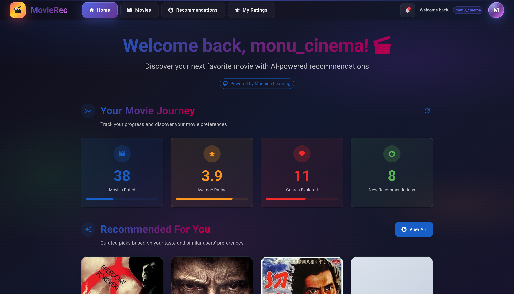
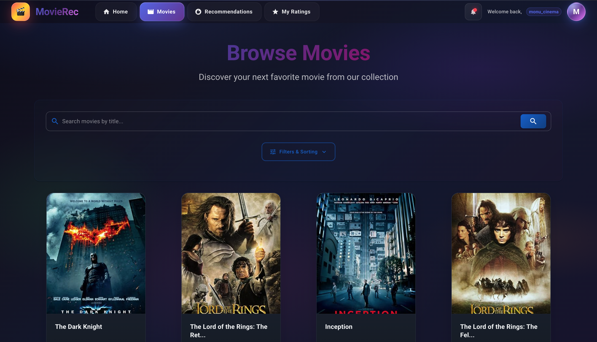
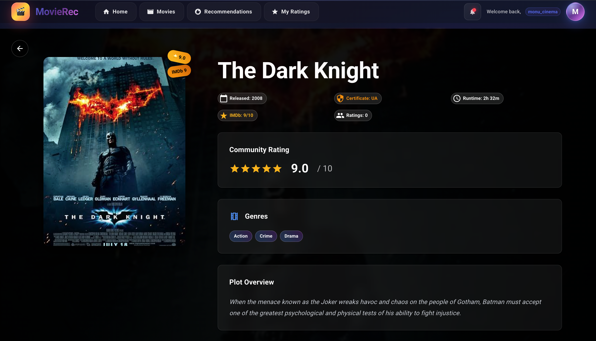
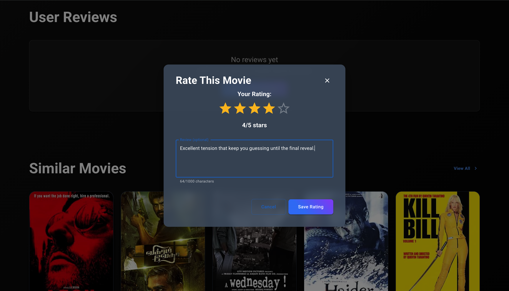
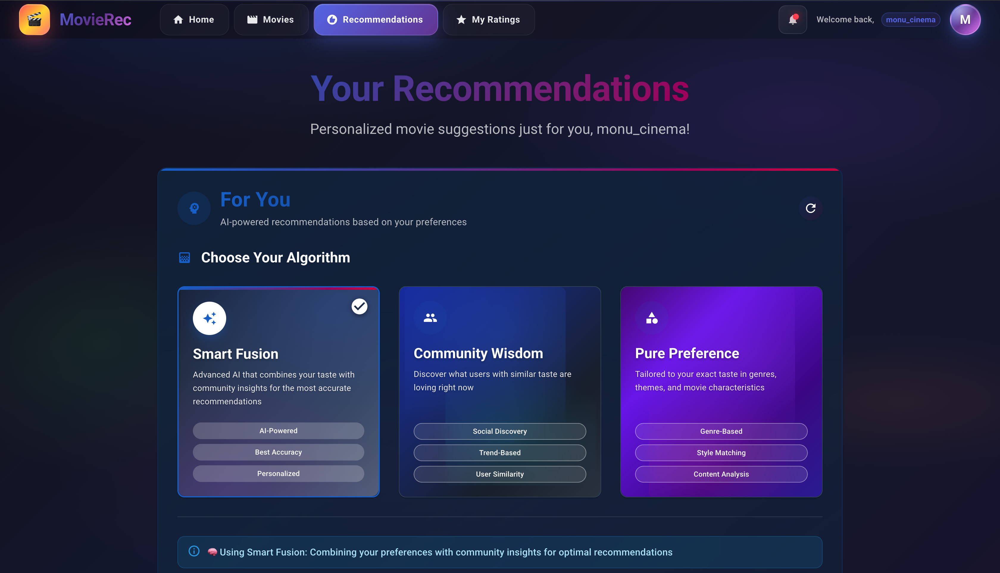
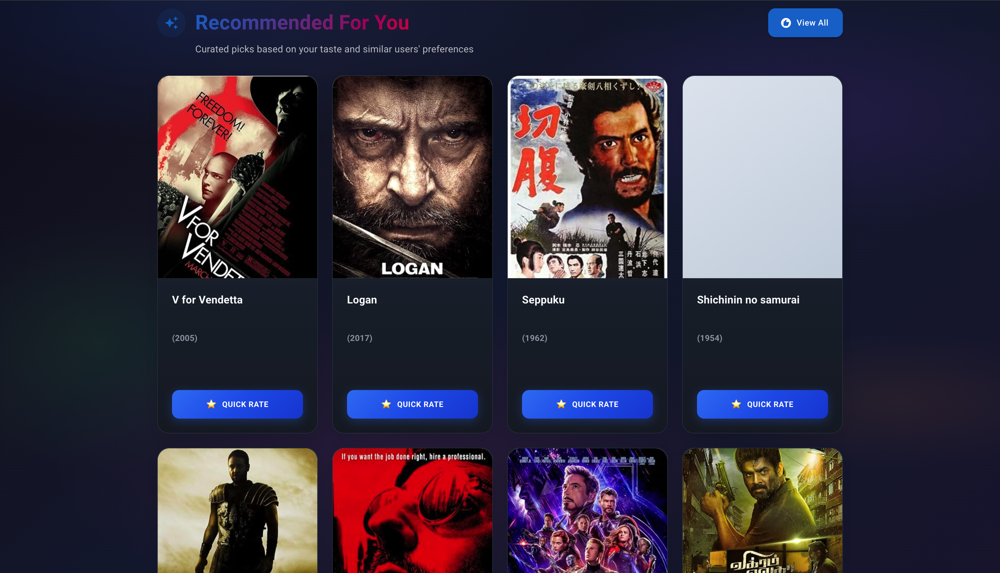

# 🍿 Popcorn - Graph-Based Movie Recommendation System

Popcorn is a full-stack movie recommendation app. It models users, movies, genres, directors, and actors as a graph in **Neo4j** and generates personalized suggestions with a hybrid of collaborative and content-based filtering.

**Live demo:** https://popcorn-flax.vercel.app

> The backend runs on Render's free tier, so the first request after a period of inactivity can take 30-60 seconds while the server wakes up.

---

## Features

- Personalized movie recommendations using a hybrid of collaborative and content-based filtering (60:40 weighting)
- Graph-based movie discovery powered by Neo4j
- Popular-movie fallback for new users with little or no rating history
- Similar-movie suggestions based on genre, director, and release era
- Genre browsing and new-release listings
- User ratings that feed back into recommendations
- Explanations of why a movie was recommended
- JWT-based registration and login

---

## Screenshots

### Home Dashboard
Personal stats (movies rated, average rating, genres explored) and recommended picks.



### Browse Movies
Search by title, with filters and sorting.



### Movie Details
Plot, genres, runtime, certificate, IMDb and community ratings.



### Rate and Review
Rate a movie from 1 to 5 stars and add an optional review.



### Choose Your Algorithm
Switch between three recommendation strategies:
- **Smart Fusion:** hybrid of your taste and community insights
- **Community Wisdom:** collaborative filtering based on users with similar taste
- **Pure Preference:** content-based filtering on genres and movie characteristics



### Personalized Recommendations
Recommendations based on your taste and similar users, with quick rating.



---

## Tech Stack

| Layer | Technology |
|---|---|
| Frontend | React, Axios, Lucide React |
| Backend | Python, Flask, Flask-CORS, Flask-JWT-Extended |
| Database | Neo4j (AuraDB) |
| Data | IMDb Top 1000 Movies dataset |
| Hosting | Vercel (frontend), Render (backend) |

---

## How It Works

Popcorn uses Neo4j to represent users, movies, genres, directors, and actors as a graph of connected entities. The recommendation engine analyzes relationships in this graph to find relevant movies based on user preferences and movie similarities.

The React frontend communicates with a Flask REST API, which handles authentication, movie operations, and recommendation requests.

### Architecture

```text
React Frontend (Vercel)
        |
        v
Flask REST API (Render)
        |
        v
Neo4j Graph Database (AuraDB)
```

### Graph Model

```text
(User)-[:RATED {rating, timestamp}]->(Movie)
(Movie)-[:HAS_GENRE]->(Genre)
(Movie)-[:DIRECTED_BY]->(Director)
(Movie)-[:STARS]->(Actor)
```

### Recommendation Engine

| Method | How it works |
|---|---|
| **Collaborative filtering** | Finds users with similar rating patterns, then recommends movies they rated highly that you have not seen. |
| **Content-based filtering** | Builds a genre preference profile from your highly rated movies and recommends well-rated movies in those genres. |
| **Hybrid** | Combines both scores (60% collaborative, 40% content-based) into one ranked list. |
| **Popular (cold start)** | New users with little history get popular movies, optionally filtered by genre. |

---

## Project Structure

```text
movie-recommendation-system/
├── backend/
│   ├── app.py
│   ├── config.py
│   ├── requirements.txt
│   ├── database/
│   │   └── init_db.py
│   ├── models/
│   ├── routes/
│   └── services/
│       ├── neo4j_service.py
│       └── recommendation_engine.py
└── frontend/
    ├── package.json
    └── src/
```

---

## Getting Started

### Prerequisites

- Python 3.9+
- Node.js 18+ and npm
- A Neo4j database. The easiest option is a free AuraDB instance from https://console.neo4j.io

### 1. Clone the repository

```bash
git clone https://github.com/Ranbeer84/movie-recommendation-system.git
cd movie-recommendation-system
```

### 2. Backend setup

macOS / Linux:

```bash
cd backend
python3 -m venv venv
source venv/bin/activate
pip install -r requirements.txt
```

Windows:

```bash
cd backend
python -m venv venv
venv\Scripts\activate
pip install -r requirements.txt
```

Create a `.env` file inside `backend/` using the configuration described in [Environment Variables](#environment-variables).

Initialize the database (run this **once**) to create constraints and indexes and load the movie data:

```bash
python database/init_db.py
```

Start the server:

```bash
python app.py
```

The backend runs at http://localhost:5000.

### 3. Frontend setup

In a second terminal:

```bash
cd frontend
npm install
npm start
```

The frontend runs at http://localhost:3000.

If the frontend reads the API URL from an environment variable, create `frontend/.env`:

```env
REACT_APP_API_URL=http://localhost:5000
```

---

## Environment Variables

### Backend (`backend/.env`)

```env
SECRET_KEY=your-secret-key
JWT_SECRET_KEY=your-jwt-secret-key
FLASK_ENV=development

NEO4J_URI=neo4j+s://<your-instance-host>.databases.neo4j.io
NEO4J_USER=<your-database-username>
NEO4J_PASSWORD=<your-database-password>
NEO4J_DATABASE=<your-database-name>

CORS_ORIGINS=http://localhost:3000
```

Replace the placeholders with the connection details shown in the Neo4j Aura console or in the credentials file you downloaded when creating the instance. Generate secure keys with:

```bash
python -c "import secrets; print(secrets.token_hex(32))"
```

### Frontend

| Variable | Description |
|---|---|
| `REACT_APP_API_URL` | Base URL of the backend API |

---

## API Overview

| Method | Endpoint | Description |
|---|---|---|
| POST | `/api/auth/register` | Create an account |
| POST | `/api/auth/login` | Log in and receive a JWT |
| GET | `/api/auth/profile` | Current user profile (auth required) |
| GET | `/api/recommendations/for-me` | Personalized hybrid recommendations (auth required) |
| GET | `/api/recommendations/popular` | Popular movies, optional genre filter |
| GET | `/api/recommendations/similar/:movie_id` | Movies similar to a given movie |
| GET | `/api/recommendations/by-genre/:genre` | Top-rated movies in a genre |
| GET | `/api/recommendations/new-releases` | Recent highly rated movies |
| GET | `/api/recommendations/explain/:user/:movie` | Why a movie was recommended |

Protected endpoints expect an `Authorization: Bearer <token>` header.

---

## Deployment

### Backend on Render

1. Create a **Web Service** connected to this GitHub repository.
2. Set **Root Directory** to `backend`.
3. Build command: `pip install -r requirements.txt`
4. Start command: `python app.py`, or `gunicorn app:app` if `app.py` exposes a Flask instance named `app` at module level.
5. Add the backend environment variables above, with `FLASK_ENV=production` and `CORS_ORIGINS` set to your Vercel URL (no trailing slash).

### Frontend on Vercel

1. Import the repository into Vercel.
2. Set **Root Directory** to `frontend`.
3. Add `REACT_APP_API_URL` pointing to your Render URL. This variable name applies to Create React App builds.
4. Deploy. Redeploy whenever you change environment variables, because React reads them at build time.

For client-side routes to survive a page refresh, add `frontend/vercel.json`:

```json
{
  "rewrites": [{ "source": "/(.*)", "destination": "/index.html" }]
}
```

---

## Troubleshooting

| Problem | Solution |
|---|---|
| `Cannot resolve address ...neo4j.io` | The Neo4j hostname does not exist. Check that the Aura instance still exists and that `NEO4J_URI` matches it. |
| `Unauthorized` from Neo4j | Check `NEO4J_USER` and `NEO4J_PASSWORD` against your Aura credentials. |
| CORS error in the browser | `CORS_ORIGINS` must exactly match the frontend URL, with no trailing slash or space. |
| Frontend loads but shows no movies | The database is empty. Run `python database/init_db.py`. |
| First request is very slow | Render's free tier is waking up. Wait about a minute and retry. |
| `.env` values are ignored | Make sure `load_dotenv()` is called in `app.py` and `.env` is inside `backend/`. |

### Database Recovery

If your Neo4j Aura instance becomes unavailable or is deleted:

1. Check the instance status in the Neo4j Aura console.
2. Create a replacement instance if necessary.
3. Update the Neo4j connection variables in Render.
4. Run the database initialization script to restore the seed data.
5. Verify that the backend and recommendation endpoints work.

Keep the initialization script and required source data in the repository so the database can be rebuilt when needed.

---

## Security Notes

- Never commit `.env` files or credentials.
- Do not hardcode passwords or connection URIs as default values in code.
- Passwords are hashed with Werkzeug (PBKDF2-SHA256) and never stored in plaintext.
- If a credential is ever exposed, reset it immediately in the Neo4j Aura console.

---

## Roadmap

- [ ] Improve recommendation relevance and ranking with adaptive hybrid weights
- [ ] Add watchlists and favorites
- [ ] Conversational recommendations using an LLM with retrieval-augmented generation
- [ ] Expand automated backend and frontend tests
- [ ] Improve error handling and application reliability

---

## Author

**Ranbeer** - [@Ranbeer84](https://github.com/Ranbeer84)

---

## License

This project is licensed under the [MIT License](LICENSE).
